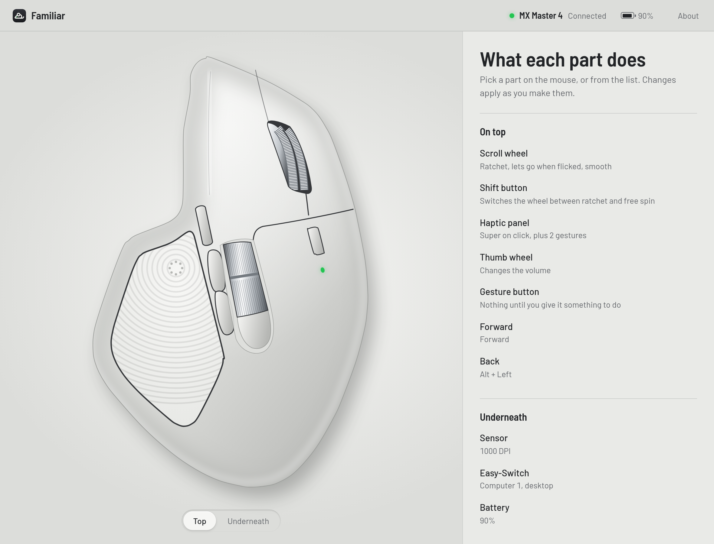
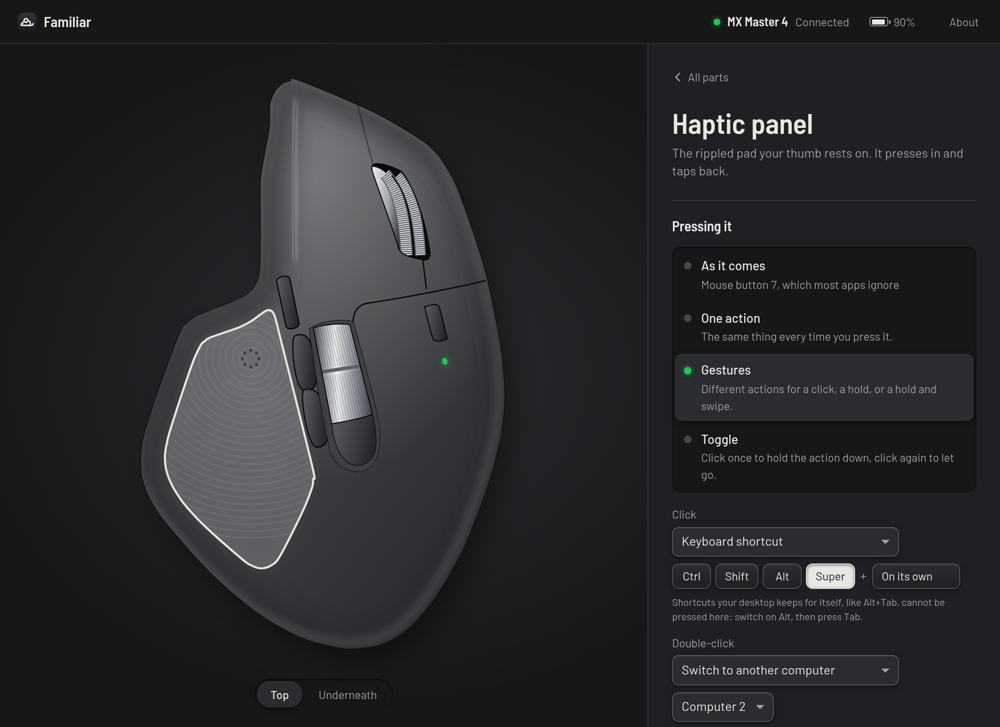
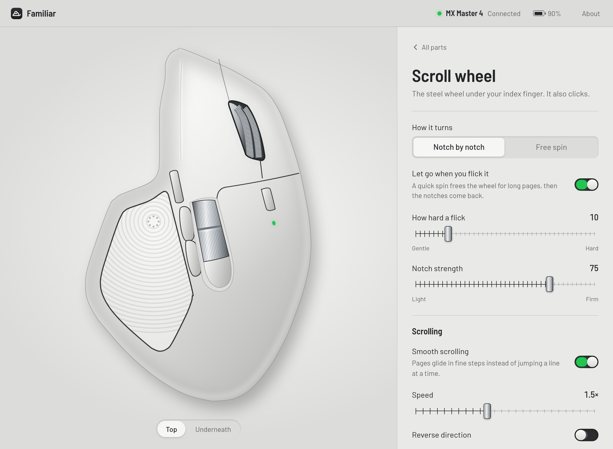
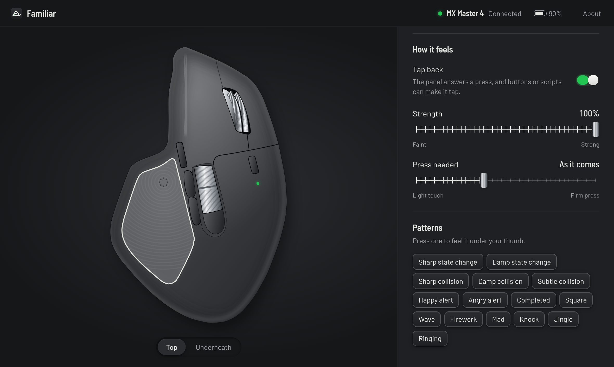
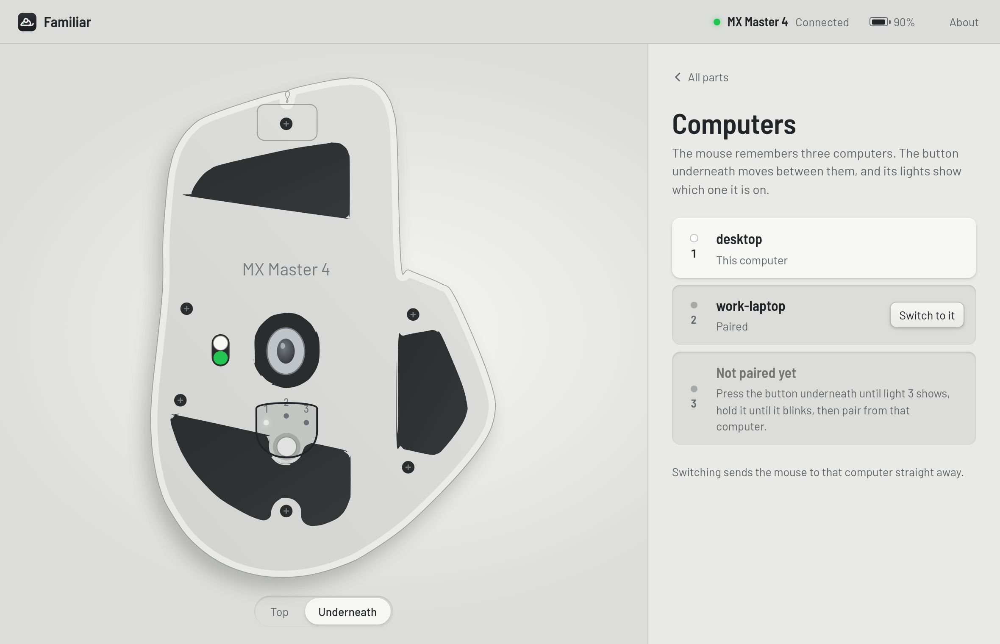
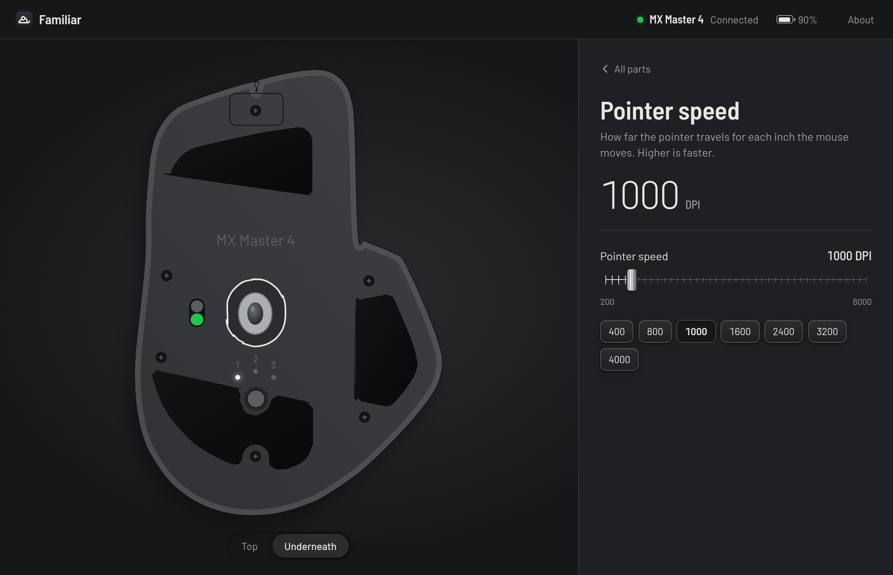

<p align="center">
  
</p>

<h1 align="center">Familiar</h1>

<p align="center">
  Open-source software for the Logitech MX Master 4 on Linux.<br>
  Remap the buttons, add gestures, tune the wheel and the haptic panel,<br>
  with no account, no cloud and no telemetry.
</p>

<p align="center">
  <a href="../../releases/latest"></a>
  <a href="../../actions/workflows/ci.yml"></a>
  
  <a href="LICENSE"></a>
</p>

<p align="center">
  <picture>
    <source media="(prefers-color-scheme: dark)" srcset="docs/screenshots/overview-dark.png">
    
  </picture>
</p>

A familiar is the small animal companion that serves a witch, and mice were
the classic choice. This one serves the MX Master. Not affiliated with
Logitech.

## Why

Logi Options+ does not run on Linux. Without it the MX Master 4 still works
as a mouse, but the haptic panel sends a button most apps ignore, the wheel
scrolls a whole notch at a time over the Bolt receiver, and there is no
built-in way to change any of it.

Familiar sets all of that up. A small daemon talks to the mouse over HID++,
and a settings window and a command line tool tell it what you want. Settings
live in one plain text file, nothing leaves your computer, and the mouse
keeps working if the daemon stops.

## What it does

The window is built around a drawing of the mouse, top and underneath. Pick a
part and change what it does; changes apply as you make them. It follows your
system's light or dark setting, drawn in the mouse's own Pale Grey or
Graphite.

### Buttons and gestures



Six buttons can be given something else to do: the wheel click, back,
forward, the gesture button, the shift button behind the wheel and the haptic
panel. Each takes one action, or a set of gestures: click, double-click,
press and hold, and hold while moving the mouse in four or eight directions.
A toggle holds an action down until you click again, for anyone who finds
holding a button hard.

An action can be a keyboard shortcut, a media key, a mouse button, a shell
command, a pointer speed, a switch to another computer or a haptic pattern.
A button set to another mouse button is remapped inside the mouse, so it
works even when the daemon is not running. Nothing is sent while the screen
is locked. See [docs/buttons.md](docs/buttons.md).

### Scrolling



Choose ratchet or free spin, how hard a flick lets the wheel go, and how firm
the notches feel. Smooth scrolling takes the wheel over and sends hi-res
scroll events, so pages move in small steps. Over a Logi Bolt receiver that
is the only way to get hi-res scrolling on Linux today.

The thumb wheel can scroll sideways at a speed you set, change the volume,
zoom or switch tabs, and a light tap on it can run an action of its own. See
[docs/scrolling.md](docs/scrolling.md).

### Haptics



Set how strongly the panel taps back and how firm a press it needs, and try
each of the mouse's built-in patterns under your thumb. Any program can play
one with `familiar haptic completed`, so a few lines of shell can buzz the
mouse when a long command or a service finishes. See
[docs/haptic-hooks.md](docs/haptic-hooks.md).

### Pointer speed and computers

<p align="center">
  
  
</p>

Underneath are the sensor and the Easy-Switch button. Set the pointer speed
from 200 to 8000 DPI, and name the three computers the mouse remembers or
send it to another one.

### Quick, light and private

Measured on an MX Master 4 over Bolt:

- Idle: 6.7 MiB of memory, 7 threads, no wakeups at all. CI fails the build
  if the daemon grows past 20 MiB or wakes more than 5 times in 10 s
  (`scripts/resource-budget.sh`).
- After a reconnect, configured settings are back in about 50 ms when the
  mouse kept them and about 130 ms when three had reset. `familiar status`
  shows the latest figure.
- No network: the systemd unit allows only Unix and netlink sockets. Check
  with `systemctl --user show familiard -p RestrictAddressFamilies`.

## What it cannot do yet

- Per-app profiles. There is one profile, used everywhere.
- The Actions Ring.
- Bluetooth is untested; development has been over a Logi Bolt receiver.
- Windows. The protocol library is portable, the rest is Linux only so far.
- Firmware updates.
- Packages other than `.deb` and `.rpm`.

## Install

Packages for each release are on the
[Releases page](https://github.com/Gingerbreadfork/familiar/releases/latest):
a `.deb` for Debian and Ubuntu and an `.rpm` for Fedora, with a `SHA256SUMS`
file alongside. They are built for x86_64.

```sh
sudo apt install ./Familiar_<version>_amd64.deb       # Debian, Ubuntu
sudo dnf install ./Familiar-<version>-1.x86_64.rpm    # Fedora
```

The package holds the daemon, the `familiar` command and the window, the udev
rule that lets you reach the mouse without root, and a systemd user service.
The daemon starts by itself from your next login. To start it straight away:

```sh
systemctl --user start familiard
```

### From source

Access to `/dev/hidraw*` is needed. Installing the udev rule once is the only
step that needs root; everything else runs as your user:

```sh
sudo cp packaging/udev/70-familiar.rules /etc/udev/rules.d/
sudo udevadm control --reload && sudo udevadm trigger
```

Then build, install to `~/.local/bin` and start the daemon as a systemd user
service. This needs a Rust toolchain and the udev development package
(`systemd-devel` on Fedora, `libudev-dev` on Debian and Ubuntu):

```sh
packaging/install-user.sh
```

To install the Familiar window as well, which needs pnpm and the WebKitGTK
development packages (`webkit2gtk4.1-devel` on Fedora):

```sh
packaging/install-user.sh --app
```

The window is a client of the daemon only: closing it changes nothing, and
every change it makes lands in the same config file. To build the `.deb` and
`.rpm` packages instead, run `packaging/build-packages.sh`.

The daemon runs under a systemd watchdog: if it ever stops responding,
systemd restarts it. The service starts with `graphical-session.target`.
GNOME and KDE Plasma reach that target on their own; on a window manager or
compositor that does not, the daemon will not start at login until the
session starts the target (for example through uwsm), or until you run
`systemctl --user start familiard` from its startup commands.

If Solaar or Logi Options+ is running it may change settings back.
`familiar status` warns when it sees one.

## The config file

Settings live in `~/.config/familiar/config.toml`; see
[packaging/config.example.toml](packaging/config.example.toml). The daemon
applies them whenever the mouse connects, wakes or comes back from another
host, and picks up edits to the file straight away. `include` pulls in
per-machine files, so one file kept in git can serve several computers, and
every write the daemon makes keeps the previous version next to the file as
`.bak`.

```toml
[device."B042"]
dpi = 1600
smartshift = 12

[profile.default.buttons]
back = "key:alt+left"
haptic = { tap = "key:super", up = "key:volumeup", down = "key:volumedown" }

[profile.default.scroll]
smooth = true
```

## The command line

```sh
familiar status                   # what the daemon sees: devices, battery, settings
familiar get                      # current settings
familiar diff                     # config against the device
familiar set dpi 1600             # through the daemon this is saved to the config
familiar set haptic 60 --temporary
familiar set wheel free           # or ratchet
familiar set smartshift 12        # shift speed, or "off"
familiar set torque 50
familiar set force 4000           # thumb panel press threshold
familiar haptic                   # list waveforms
familiar haptic completed         # play one
familiar host 2                   # Easy-Switch to channel 2
familiar host --rename laptop     # rename the current channel
familiar undivert                 # put every control back to normal
familiar diagnostics              # one file for bug reports, sent nowhere
familiar reload                   # reread the config now
familiar list                     # receivers and paired devices
familiar dump                     # identity, features, every readable setting
familiar events --divert gesture --raw-xy --thumb
```

When `familiard` is running, `get`, `set`, `haptic` and `host` go through it.
`--direct` talks to the device instead; the daemon will then put its own
settings back the next time the device reconnects.

`events` temporarily routes the named controls to HID++ and prints what the
mouse sends; everything is restored on exit. `--json` prints one object per
line, see [docs/events.md](docs/events.md). If something was killed and left a
button dead, `familiar undivert` puts it back, and the daemon does the same
whenever it starts or stops.

The daemon's D-Bus API is described in [docs/dbus.md](docs/dbus.md), and what
has been learned about the mouse itself is in
[docs/protocol/mx-master-4.md](docs/protocol/mx-master-4.md).

## Working on it

```sh
cargo test                        # everything, against a simulated mouse
cargo clippy --all-targets
pnpm --dir gui install
pnpm --dir gui dev                # the window in a browser, with stand-in data
pnpm --dir gui tauri dev          # the window itself, talking to the daemon
```

No hardware is needed for the tests: `familiar-hidpp` includes a simulated
mouse behind a receiver, and the daemon's tests run against it.

### Releasing

Pushing a tag like `v0.2.0` runs the release workflow, which runs the tests,
builds the packages on Ubuntu 22.04 and attaches them to a GitHub release with
their checksums. The tag has to match the version in `Cargo.toml`,
`gui/src-tauri/Cargo.toml`, `gui/src-tauri/tauri.conf.json` and
`gui/package.json`; `scripts/check-version.sh` tells you whether all four
agree. Starting the workflow by hand builds the packages and keeps them with
the run, without releasing anything.

### Layout

| Path | Purpose |
|---|---|
| `crates/familiar-hidpp` | HID++ framing, feature discovery, typed features, call allowlist |
| `crates/familiar-hidraw` | Linux hidraw transport |
| `crates/familiar-core` | Settings model and config file |
| `crates/familiar-client` | D-Bus client shared by the command line tool and the window |
| `crates/familiard` | Daemon: applies settings, D-Bus API, notifications |
| `crates/familiar-cli` | Command line tool |
| `gui` | The Familiar window, Tauri and Svelte |
| `docs/protocol` | What we have learned about the device |
| `packaging` | udev rule, systemd units, desktop entry, example config |

### Safety

The `hidpp` crate refuses to call any function it does not know to be safe.
Internal, hidden and firmware update features are never touched, even with
`dump --research`.

## License

[MIT](LICENSE). The Barlow fonts bundled with the window are under the SIL
Open Font License.
